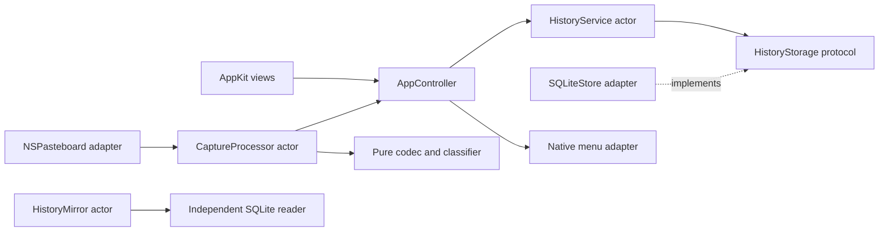

# 原生架构

项目按领域、用例、存储适配、系统适配及界面组织，使用两个 Swift Package target：
`ClipEchoCore` 不依赖 AppKit，`ClipEcho` 负责原生系统集成和展示。领域规则可以脱离
应用窗口独立测试，SQLite 数据格式兼容是存储适配器的职责。

```text
Sources/
  ClipEchoCore/
    Domain/          模型、剪贴板协议规则、HistoryStorage 接口
    Application/     HistoryService actor，独占存储适配器
    Clipboard/       CSB1 编解码、表示选择、摘要、内容标识及资源限制
    Persistence/     SQLite、设置、搜索、保留策略、私有路径及位置迁移
    Export/          可选 JSONL 镜像 actor
  ClipEcho/
    Application/     组合入口、AppDelegate、应用协调器
    System/          NSPasteboard、菜单栏、登录启动及单实例适配
    Presentation/
      History/       原版卡片流、内联预览、游标、搜索和操作状态
      Settings/      分组设置及表单验证
      Shared/        原版文案、确认浮层及公共视图
    Diagnostics/     使用独立剪贴板和临时数据库的原生自检
```

## 依赖和职责



`ClipEchoApp` 是组合入口，构造 SQLite 适配器并以 `sending` 转交给 `HistoryService`。
应用服务只持有 `HistoryStorage` 接口；界面不接触 SQL、连接或数据库锁。
`AppController` 将界面操作转换成应用服务调用，维护设置及统计的只读快照，并统一
触发历史、菜单栏、主题和镜像刷新。登录状态通过 `LoginItemManaging` 从系统读取。

历史控制器负责卡片、游标、搜索、内联展开、恢复反馈和滚动锚点。媒体视图只接收
已加载的有界内容，不自行打开数据库；HTML 在隔离的系统 WebKit 视图中使用原版
过滤规则和预览样式。设置控制器验证表单并发出用户意图；存储位置及容量来自服务
快照。配色、尺寸、布局和文案以原版最终 CSS 及语言目录为准，语言只保存偏好。

架构重组只改变内部职责。产品兼容包含 600×700 无标题窗口、40px 历史拖拽区、
原版卡片及内联展开、设置侧栏及主题卡片、菜单分组、180ms 搜索、50 条分页、
1400ms 恢复反馈和 320ms 回顶。固定后回顶，取消固定/删除保留锚点；窗口聚焦时
新记录保持锚点，失焦时回顶。设置页不查询历史，返回历史时开始新会话。

## 并发与数据流

UI、窗口、菜单和 `NSPasteboard` 均限制在 `MainActor`。粘贴板发生变化后，先检查
所有项目的类型标记；隐藏、临时、自动生成及受支持的密码管理器内容在读取正文前
就被丢弃。原生读取生成可传递的事件，分类、哈希、资源检查、摘要和编码由串行
`CaptureProcessor` actor 执行，最多保留两个待处理正文，完成回调保持采集顺序。

`HistoryService` actor 独占 SQLite 连接；查询和变更按序执行，事务统一处理搜索索引、
去重和保留。分页只读取持久化摘要，详情只读取一个有界事件。刷新任务合并短时间
内的变化，搜索和分页请求携带世代号，过期结果不会覆盖新的界面状态。

恢复先从服务取得一个事件，再在后台解码及投影，最后在主线程写入剪贴板。恢复
补充唯一的来源和远程标记。系统剪贴板的变更计数形成一次性回声抑制；下一次外部
复制不会因内容相同而被丢弃。成功写入后，排序更新失败只记录后台故障，不把已经
成功的恢复显示为失败；排序后处理错误仍在页面提示。

镜像使用独立 actor 和只读连接，在一个 SQLite 读事务内逐行生成 JSONL，不占用
应用服务连接。刷新信号不携带正文，短时间内合并，写入 `0600` 临时文件并同步后
原子替换。迁移先暂停镜像读取，再在线备份到私有目标、校验、保存恢复记录并切换
配置；删除来源文件是提交点。失败保留来源或可恢复的快照，成功后镜像跟随新路径。

## 兼容性和错误边界

领域规则保留原有内容标识、格式优先级、精简投影、置顶保护及来源协议。SQLite
适配器负责 v4 表结构、CSB1 事件和 FTS5 搜索的一致性；纯核心测试使用显式 Rust
编码夹具验证格式。未知数据库版本、无效列形状、危险文件路径及覆盖冲突会失败，
不会创建替代的空历史。

普通错误只呈现本地化的固定消息；日志不包含剪贴板正文、来源标识、哈希或路径。
系统默认目录的 `/var`、`/tmp` 别名通过经过验证的 POSIX `realpath` 处理；不能用
Foundation 的标准化替代，因为它在 macOS 上可能重新引入 `/private` 别名。

自动测试覆盖编解码、协议过滤、数据库共享、排序、搜索、容量、置顶、迁移回滚、
镜像原子替换及 actor 下的并发采集。原生自检和人工桌面验证分别覆盖系统 API 及
用户可见行为。
